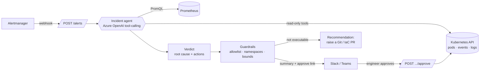

# AIOps Incident Agent

[](https://github.com/chandrasekhar-genai/agentic-ai/actions/workflows/aiops-incident-agent.yml)


An LLM agent that picks up a Prometheus alert, investigates it the way an
on-call SRE would (pod status, events, logs, PromQL), writes the root cause to
Slack/Teams, and proposes a fix that **only runs after a named engineer
approves it**.

> Goal: cut *time to diagnose* without handing an LLM the keys to production.

## How it works



1. Alertmanager posts the alert to `/alerts`.
2. The agent loops: the model chooses read-only tools, sees redacted and
   truncated output, and stops when the evidence supports a root cause
   (bounded by `MAX_AGENT_STEPS`).
3. The verdict is validated. Only `rollout_restart` and `scale_deployment` on
   Deployments in allowed namespaces, within replica bounds, can be executed.
   Everything else becomes a pull-request recommendation.
4. The summary is posted to chat with approve links. Approval records who
   approved and what happened.

## Try it in 30 seconds (no cluster, no API key)

```bash
pip install -e ".[dev]"
make demo      # runs two recorded scenarios through the full agent loop
make test
```

Example output for a crash-looping service:

```text
*KubePodCrashLooping* in `shop` – confidence: high
*Summary:* checkout-api is crash-looping because its container is OOMKilled on start-up.
*Root cause:* Container memory usage exceeds its 512Mi limit during cache warm-up (working set
~511Mi just before the kill; logs show the full SKU cache loaded into memory).
• `increase_memory_limit` on `deployment/checkout-api` (needs PR) – Raise the memory limit
  (e.g. 512Mi -> 1Gi) in the Helm values via a reviewed PR.
• `code_change` on `deployment/checkout-api` (needs PR) – Load the SKU cache lazily or page it.
_Evidence: 6 tool calls, 3 reasoning steps_
```

…and for a latency alert, where a live action *is* proposed:

```text
*HighRequestLatencyP99* in `payments` – confidence: medium
*Summary:* payments-api is CPU-saturated at 3 replicas and has no autoscaler.
• [0] `scale_deployment` on `deployment/payments-api` {'replicas': 5}
   approve: `POST /incidents/6a711e543b46/actions/0/approve`
• `add_hpa` on `deployment/payments-api` (needs PR) – Add an HPA in Git so the manual
  scale is not reverted on the next sync.
```

Run the API locally and drive it with curl:

```bash
make run
curl -s localhost:8080/alerts -H 'content-type: application/json' -d @examples/alert-latency.json
curl -s localhost:8080/incidents | jq
curl -s -X POST localhost:8080/incidents/<id>/actions/0/approve -H 'X-Approver: you@example.com'
```

## Use a real model and cluster

| Variable | Purpose |
|---|---|
| `LLM_PROVIDER=azure` | Use Azure OpenAI / Azure AI Foundry (default `offline`) |
| `AZURE_OPENAI_ENDPOINT`, `AZURE_OPENAI_DEPLOYMENT` | Model endpoint and deployment name |
| `AZURE_OPENAI_API_KEY` | Optional. If unset, Entra ID via `DefaultAzureCredential` (Workload Identity) |
| `AIOPS_DEMO=0` | Use the real Kubernetes API (in-cluster or kubeconfig) and `PROMETHEUS_URL` |
| `NOTIFY_WEBHOOK_URL` | Slack or Teams incoming webhook |
| `ALLOWED_NAMESPACES`, `MAX_SCALE_REPLICAS`, `MAX_AGENT_STEPS` | Guardrails |
| `APPROVAL_TOKEN` | Shared token required on approve/reject (defence in depth) |

## Deploy to AKS with GitOps

- Helm chart: [`deploy/helm/aiops-agent`](deploy/helm/aiops-agent). Non-root,
  read-only root filesystem, all capabilities dropped, Azure Workload Identity.
- Least-privilege RBAC mirrors the action allowlist: read pods/logs/events,
  get/patch deployments and `deployments/scale`. No Secrets, no delete, no exec.
- Argo CD application: [`deploy/argocd/application.yaml`](deploy/argocd/application.yaml)
- Alertmanager route: [`examples/alertmanager-receiver.yaml`](examples/alertmanager-receiver.yaml)

CI runs lint, tests and the offline demo, lints and renders the chart, builds the
image, and fails on HIGH/CRITICAL Trivy findings before pushing to GHCR.

## Design decisions

- [ADR 0001 – Human-in-the-loop remediation with an action allowlist](docs/adr/0001-human-in-the-loop-remediation.md)
- [ADR 0002 – Azure OpenAI behind a provider interface, with an offline planner](docs/adr/0002-llm-provider-abstraction.md)

Security notes: logs and events are untrusted input (prompt injection), so the
model has no write tools at all; tool output is redacted for common secret
patterns and truncated before it reaches the model or the chat channel.

## Production hardening (roadmap)

- Persist incidents in Postgres/Cosmos DB so the service can run multiple replicas
- Interactive Slack/Teams approval buttons with OIDC-verified identities
- Pull traces via OpenTelemetry (Tempo / Azure Monitor) as an extra tool
- Evaluation set of recorded incidents, scored in CI against the offline baseline
- Open the recommended PRs automatically (Helm values, HPA) for GitOps repos

## Project layout

```text
src/aiops_agent/
  app.py          FastAPI: /alerts, /incidents, approve/reject
  agent.py        investigation loop and verdict parsing
  llm.py          Azure OpenAI provider + offline planner
  tools.py        read-only tools, redaction, truncation
  remediation.py  allowlist, bounds, execution
  backends.py     Kubernetes, Prometheus, demo fixtures
  notify.py       Slack / Teams messages
deploy/           Helm chart, Argo CD application
docs/adr/         architecture decision records
```

## License

MIT – see the [repository license](../LICENSE).
