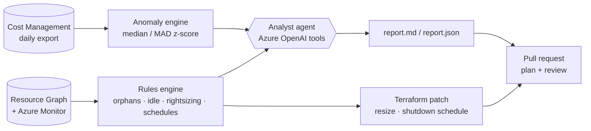

# Azure FinOps Agent

[](https://github.com/chandrasekhar-genai/agentic-ai/actions/workflows/azure-finops-agent.yml)


Weekly cost review for Azure, done by an agent: it finds **cost anomalies**,
**orphaned and idle resources** and **oversized VMs**, explains them in plain
language, and opens a **Terraform pull request** with the fixes for the
resources that are managed as code.

> Deterministic engines produce every number; the LLM investigates, explains and
> prioritises. Nothing is changed in Azure directly. Fixes go through your
> normal plan → review → apply pipeline.

## How it works



| Check | Rule (defaults, configurable) | Fix |
|---|---|---|
| Cost anomaly | daily service cost vs 14-day median, robust z ≥ 3.5 and ≥ 20 excess | investigate, top contributing resources listed |
| Orphaned disk | managed disk `Unattached` | snapshot, then delete |
| Orphaned public IP | no NIC / LB / gateway / NAT association | release |
| Stopped, not deallocated | VM `PowerState/stopped` | deallocate |
| Idle VM | CPU avg < 5% and max < 15% over 30 days | confirm owner, deallocate |
| Non-prod 24×7 | `env` tag in dev/test/qa/sandbox | nightly auto-shutdown (Terraform) |
| Oversized VM | CPU avg < 20%, max < 35%, memory < 50% | halve vCPUs in the same series (Terraform) |

## Try it (no Azure account needed)

```bash
pip install -e ".[dev]"
finops-agent analyze --costs examples/costs.csv --inventory examples/inventory.csv \
  --tf-dir examples/terraform --out out
```

From the sample data (60 days, synthetic, see `examples/generate_sample.py`):

```text
6 findings, 3 anomalies, ~USD 939/month savings -> out/report.md
```

```markdown
## Executive summary
6 optimisations worth about **USD 939/month** were found, and 1 service(s) show a cost
anomaly that needs attention now. 3 are low-risk and can go straight into a change; 3 need
owner sign-off.

## Investigate now
- **Log Analytics** since 2026-11-18 (3 day(s)): ~USD 164/day vs ~USD 41 expected,
  USD 371 over baseline so far, driven by `law-platform-prod`. Typical causes: debug/verbose
  logging after a release, a new diagnostic setting, or a noisy container...
```

and a patch that `git apply`s cleanly:

```diff
-  size                  = "Standard_D16s_v5"
+  size                  = "Standard_D8s_v5"
...
+resource "azurerm_dev_test_global_vm_shutdown_schedule" "build_dev_01" {
+  virtual_machine_id    = azurerm_linux_virtual_machine.build_dev_01.id
+  daily_recurrence_time = "2000"
+  timezone              = "Arabian Standard Time"
```

## Run it against your subscription

1. Create a daily **Cost Management export** (actual cost, CSV) to a storage
   account. The loader accepts old and new export schemas (column casing,
   `MM/DD/YYYY` or ISO dates, any billing currency).
2. Build the inventory with Resource Graph and Azure Monitor:
   ```bash
   az login
   python scripts/build_inventory.py --subscription <id> > inventory.csv
   ```
   Queries live in [`kql/`](kql) so they can be reused in Azure Workbooks.
3. Analyse with the model:
   ```bash
   pip install ".[azure]"
   export AZURE_OPENAI_ENDPOINT=https://<resource>.openai.azure.com/ AZURE_OPENAI_DEPLOYMENT=gpt-4o
   finops-agent analyze --llm azure --costs costs.csv --inventory inventory.csv --tf-dir infra --out out
   ```
   Without `AZURE_OPENAI_API_KEY` it authenticates with Entra ID (`DefaultAzureCredential`).

### Scheduled in GitHub Actions

[`examples/weekly-finops.yml`](examples/weekly-finops.yml) (copy it into your infrastructure repo) runs every Monday:
OIDC login (no stored secrets) → latest export → inventory → analysis → a pull
request with the Terraform changes and the report as its description.
Least privilege: Reader, Storage Blob Data Reader, Azure OpenAI User.

`--fail-on-anomaly` exits with code 2 so a pipeline can page or block on spikes.

## Design decisions

- [ADR 0001 – Numbers from engines, narrative from the model](docs/adr/0001-engines-for-numbers-llm-for-narrative.md)

## Roadmap

- Reservation / savings plan coverage from amortized-cost exports
- AKS cost allocation per namespace (OpenCost) as an extra data source
- Tag-compliance findings (missing `owner` / `cost-center`)
- Post the summary to Teams with owner mentions from tags

## License

MIT – see the [repository license](../LICENSE).
