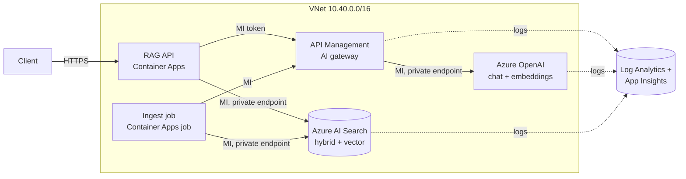

# Azure RAG Landing Zone

[](https://github.com/chandrasekhar-genai/agentic-ai/actions/workflows/azure-rag-landing-zone.yml)


A production-shaped **retrieval-augmented generation (RAG)** platform on Azure,
built the way regulated and sovereign environments need it:

- **Private by default.** Azure OpenAI and Azure AI Search have public network
  access disabled and are reachable only through private endpoints.
- **Keyless.** API keys are disabled on both services. Every hop uses Entra ID
  managed identities.
- **AI gateway.** Azure API Management validates caller identity, enforces a
  per-identity **token budget**, retries on 429/5xx and authenticates to the
  model with its own managed identity.
- **LLMOps gate.** Every deployment is evaluated against a golden question set.
  Retrieval hit rate, answer recall, citation rate, refusal accuracy and p95
  latency must meet thresholds or the pipeline fails.

## Architecture



| Identity | Can do | Cannot do |
|---|---|---|
| RAG API (user-assigned MI) | read the search index; call models via APIM | write the index, reach Azure OpenAI directly |
| Ingest job (user-assigned MI) | create and write the index; embeddings via APIM | serve traffic |
| APIM (system MI) | `Cognitive Services OpenAI User` on Azure OpenAI | anything else |

### What the gateway policy does ([`openai.xml.tftpl`](infra/policies/openai.xml.tftpl))

1. `validate-azure-ad-token`: only the API and ingest identities are accepted.
2. `azure-openai-token-limit`: tokens-per-minute budget per calling identity
   (`appid` claim), so one noisy client cannot starve the others.
3. `authentication-managed-identity`: the gateway, not the app, holds model access.
4. `retry` on 429 and 5xx with backoff.

## Try the app offline (no Azure needed)

The RAG pipeline has a deterministic local mode (hashed embeddings, in-memory
search, extractive answers) so the API, tests and the eval gate run anywhere:

```bash
pip install -e ".[dev]"
make test
make eval
make run   # then:
curl -s localhost:8080/chat -H 'content-type: application/json' \
  -d '{"question":"What is the RPO for tier-1 services?"}' | jq
```

```json
{
  "answer": "The recovery point objective (RPO) for tier-1 services is 15 minutes. [1] ...",
  "citations": [{"ref": 1, "source": "backup-and-restore.md", "title": "Databases"}],
  "retrieved": ["backup-and-restore.md", "..."],
  "latency_ms": 2
}
```

Out-of-scope questions are refused: *"I don't know based on the available documents."*

## LLMOps evaluation gate

[`evals/run_eval.py`](evals/run_eval.py) runs [`golden.jsonl`](evals/golden.jsonl)
(in-scope and out-of-scope questions) against the pipeline or a deployed URL and
writes a summary to the GitHub job:

| Metric | Meaning | Threshold |
|---|---|---:|
| retrieval_hit_rate | expected document is among the retrieved chunks | 0.90 |
| answer_recall | answer contains the required facts | 0.80 |
| citation_rate | answer cites the expected document | 0.90 |
| refusal_accuracy | out-of-scope questions are refused | 1.00 |
| p95_latency_ms | end-to-end latency | 4000 |

The offline baseline scores 1.0 / 0.9 / 1.0 / 1.0. A new prompt, model version
or chunking strategy has to keep the gate green before it reaches production.

## Deploy

```bash
cd infra
cp terraform.tfvars.example terraform.tfvars   # set name, region, publisher
terraform init && terraform apply
az containerapp job start -n caj-ingest-<name> -g rg-<name>   # index the docs from inside the VNet
python ../evals/run_eval.py --api-url "$(terraform output -raw rag_api_url)"
```

Or run the [`azure-rag-landing-zone-deploy`](../.github/workflows/azure-rag-landing-zone-deploy.yml) workflow:
build image → `terraform plan/apply` behind a GitHub environment approval
(OIDC, no stored secrets) → ingestion job → eval gate against the live API.

Notes:
- Check that your chosen models and versions are offered in your region
  (`openai_location` can differ from `location`).
- Use `apim_sku = "Premium_1"` for production. Developer has no SLA.
- APIM Developer and AI Search Basic are the main fixed costs; `terraform destroy` when idle.
- If you set `allowed_ip_ranges`, include your CI runners or run the eval from a self-hosted runner.
- Terraform is checked in CI with `fmt`, `validate`, tflint and Checkov.
  Apply to a sandbox subscription before you rely on it.

## Design decisions

- [ADR 0001 – APIM as the AI gateway in front of a private Azure OpenAI](docs/adr/0001-apim-ai-gateway.md)
- [ADR 0002 – Evaluation gate in the deployment pipeline](docs/adr/0002-llmops-eval-gate.md)

## Roadmap

- Second Azure OpenAI backend in another region with APIM load balancing and circuit breaker
- Blob storage + Search indexer with integrated vectorisation for continuous ingestion
- Semantic ranker and LLM-as-judge groundedness score in the eval
- Container Apps authentication (Entra ID) in front of the API

## Layout

```text
infra/            Terraform: network, private endpoints, OpenAI, Search, APIM, Container Apps, RBAC
infra/policies/   APIM gateway policy
app/rag/          FastAPI RAG service, ingestion, Azure + offline clients
data/docs/        sample knowledge base (fictional platform runbooks)
evals/            golden set, thresholds, eval runner
docs/adr/         architecture decision records
```

## License

MIT – see the [repository license](../LICENSE).
